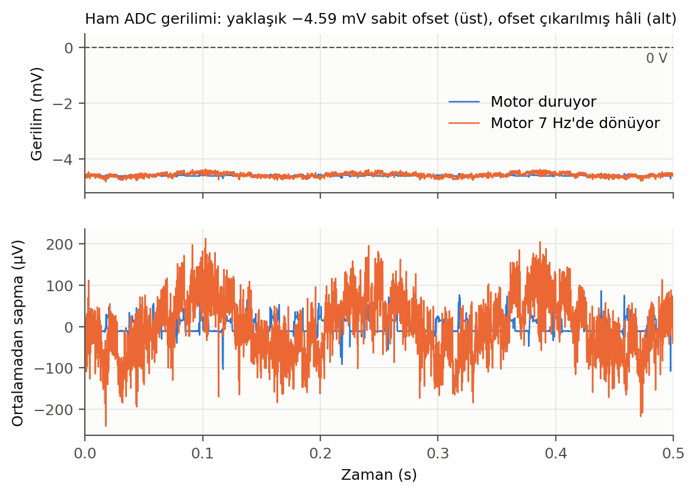
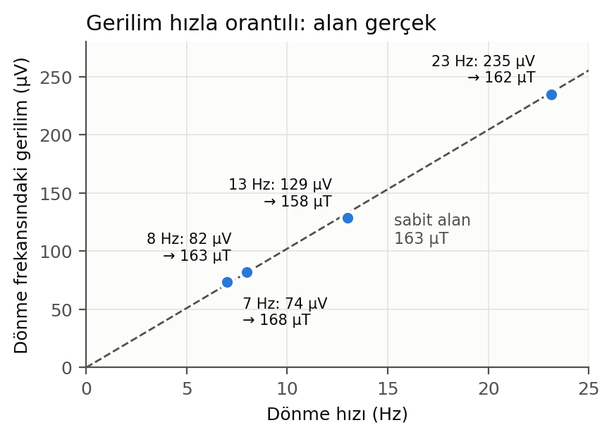
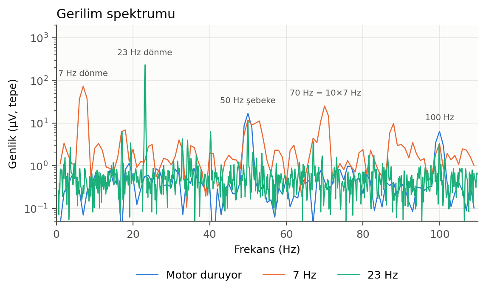
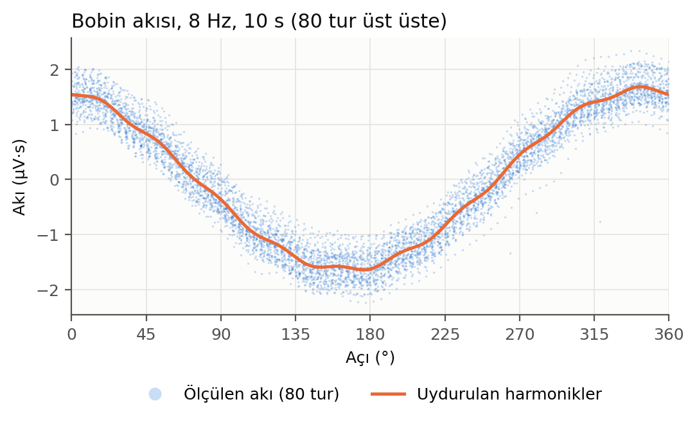
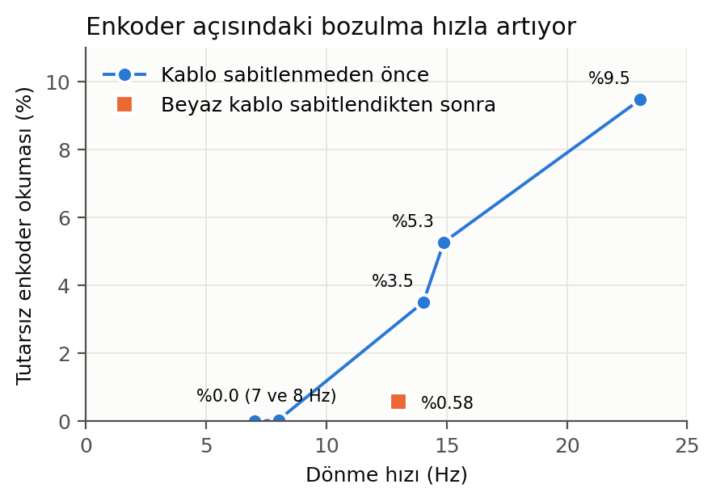
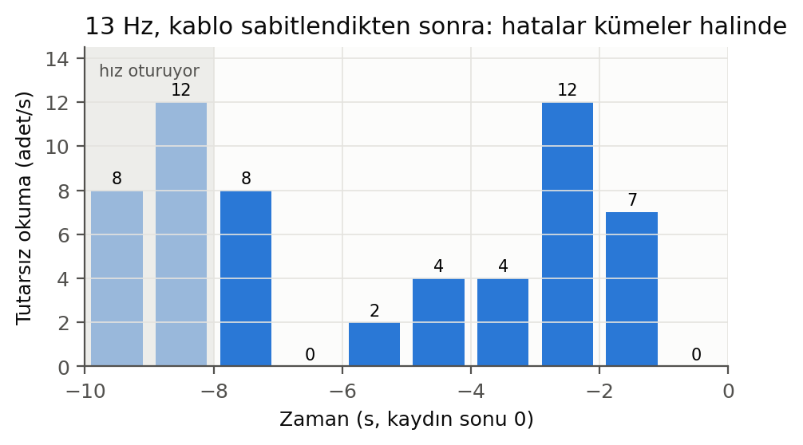

# Özet

Bu rapor, 4 Kasım 2026'da dönen bobin (rotating coil) sistemiyle yapılan ilk ölçümleri ve bu sırada yazılımda yapılan düzenlemeleri anlatıyor. Ölçümler kuadrupol mıknatıs **takılı değilken** alındı. Yani bobin yalnızca ortamın kendi manyetik alanını ölçtü.

Ana sonuçlar dört tane:

1. **Ortamda gerçek ve kararlı bir dipol alanı var: yaklaşık 163 µT.** Bu değer 7, 8, 13 ve 23 Hz dönme hızlarında birbirinden en fazla %6 farklı çıktı. Bobin gerilimi hızla orantılı arttı. Bu, sinyalin gerçekten bobinde indüklendiğini gösteriyor. Dünya'nın manyetik alanı 25–65 µT arasında olduğundan, yakında başka bir kaynak (demir ya da bir mıknatıs) olmalı.
2. **ADC girişinde yaklaşık −4.59 mV'luk sabit bir ofset var, ama sonuçları etkilemiyor.** Hesap bu ofseti tamamen temizliyor.
3. **Hızı düşürünce alan değerlerinin büyümesinin nedeni normalizasyon değil.** Neden, motor dönerken ortaya çıkan düşük frekanslı (0–6 Hz) bir gürültü ve tek turluk ölçüm penceresi.
4. **Enkoder açısı yüksek hızda bozuluyor.** 8 Hz'de hiç bozulma yok. 23 Hz'de okumaların %9.5'i tutarsız ve %23'ü eksik. Beyaz kablo sabitlenince 13 Hz'de bozulma yaklaşık beş kat azaldı ama sıfırlanmadı. Kayar halkanın (slip ring) içinde bulunduğu gri kutunun yüksek hızda sallanması güçlü bir aday.

Şu an güvenilir harmonik ölçümü **8 Hz ve altında** alınabiliyor.

# 1. Bu raporda iddialar nasıl işaretlendi

Raporda her önemli iddia üç türden biri olarak işaretlendi:

- **[BELGELENMİŞ]**: Ölçüm dosyalarından ya da koddan doğrudan hesaplanan, tekrar üretilebilen sonuç.
- **[YORUM]**: Belgelenmiş sonuçlardan yapılan, makul ama başka açıklamalara da açık çıkarım.
- **[HİPOTEZ]**: Henüz test edilmemiş açıklama ya da tahmin. Doğrulamak için ayrı bir ölçüm gerekiyor.

Raporda verilen bütün sayılar `donen_bobin/olcumler/` klasöründeki ham kayıtlardan, programın kendi hesap fonksiyonu (`olcum_hesapla`) ve aynı gün yazılan analiz betikleriyle yeniden hesaplandı. Grafikleri üreten betik `donen_bobin/rapor_sekilleri/sekilleri_ciz.py` dosyasında duruyor. Bu betiği çalıştırmak bütün şekilleri ve sayıları yeniden üretir.

# 2. Yazılım tarafında yapılanlar

## 2.1 Depo ve klasör düzeni

GitHub'daki `selcuk-hoo/dipole-correction-at-quad` deposu kontrol edildi. Yerel kopya en son sürümdeydi.

Dönen bobin kodunun bulunduğu klasörün adı `donen_bobin_surum_24_eylul_2026/` idi. Bu ad yanıltıcıydı. Klasör 24 Eylül'de açılmıştı ama içindeki kod 9–10 Ekim'de büyük ölçüde güncellenmişti (en önemli parça olan `merkezleme_olcer.py` 9 Ekim'de yazılmış). 24 Eylül'ün gerçek hâli zaten git'te `lab-testi-oncesi-2026-09-24` etiketiyle saklanıyordu. Bu yüzden klasörün adı `donen_bobin/` olarak değiştirildi. Eski sürümler `eski-surumler/` klasörüne toplandı. README, `.gitignore`, YAML ve kod içindeki bütün yol referansları güncellendi. Taşıma git'te "yeniden adlandırma" olarak kaydedildi, böylece dosyaların geçmişi korundu.

## 2.2 Çalışma ortamı

Programın Python bağımlılıkları için ayrı bir sanal ortam kuruldu: `~/venvs/merkezleme`. Bu ortam sistemde kurulu paketleri (numpy, scipy, PySide6, PyYAML) görüyor. Yalnızca eksik olan `pyqtgraph` ve `vispy` bu ortama kuruldu. Böylece mevcut `ml` ve `phys6010` ortamlarına dokunulmadı.

Sistemdeki PySide6 apt ile parça parça kurulmuştu. İki eksik parça apt ile eklendi: `python3-pyside6.qtopengl` ve `python3-pyside6.qtopenglwidgets`. Büyük arayüz (`radarMGF.py`) bir üçüncü parçayı (`QtTest`) da istiyor. O henüz kurulmadı.

Bu düzenlemelerden sonra bütün testler geçiyor: ana merkezleme programı 169/169, dönen bobin programı 55/55.

## 2.3 Ölçüm penceresine eklenenler

Ölçüm penceresinde (`merkezleme_olcer.py`) şunlar eklendi:

- **"Ham gerilim" sekmesi.** ADC'nin kaydettiği ham bobin gerilimini gösteriyor. Motor dururken de çalışıyor ve cihaza hiçbir komut göndermiyor. Ekranda saniyede gelen örnek sayısı (örnek akışı), ortalama (DC), ortalaması çıkarılmış standart sapma, en küçük/en büyük değer ve tepe değeri görünüyor. Ayrıca gerilimin zamana karşı grafiği var.
- **"Kaydet" düğmesi.** Ekranda gösterilen süredeki ham örnekleri (zaman, enkoder açısı, gerilim) ölçüm koşullarıyla birlikte `donen_bobin/olcumler/ham_<tarih>.csv` dosyasına yazıyor. Bu rapordaki analizlerin hepsi bu dosyalardan yapıldı.
- **Kayıt göstergesi.** Kayıttan sonra düğmenin yanında 5 saniye boyunca kırmızı bir nokta ve dosya adı çıkıyor.
- **"Sinyal tepesi" etiketinin düzeltilmesi.** Bu etiket yalnızca bir ölçüm alındığında güncelleniyordu. Motor durduğunda eski değeri göstermeye devam ediyordu ve bu, sanki motor dururken de ölçülüyormuş izlenimi veriyordu. Etiketin adı "Sinyal tepesi (son ölçüm)" olarak değiştirildi.
- Varsayılan arayüz teması açık renk yapıldı.

# 3. Donanımda bulunan ilk sorun: rotor çevrimdışı

İlk denemede motor dönüyordu ama hiçbir alan değeri gelmiyordu. Pencere rotoru "ÇEVRİMDIŞI" gösteriyordu.

Firmware'de stator, rotordan son bir saniye içinde hiç paket almazsa rotoru çevrimdışı sayıyor [BELGELENMİŞ: `stator.cpp`]. Ölçüm programı da rotor çevrimdışıyken hiç ölçüm başlatmıyor. Motorun dönebilmesi ise yanıltıcıydı, çünkü motor hızı statordaki enkoderden okunuyor ve rotora ihtiyaç duymuyor.

Kontrol edilince enkoder kablosunun takılı olmadığı görüldü. Kablo takılınca rotor çevrimiçi oldu ve ölçümler başladı.

# 4. Alınan ölçümler

Aşağıdaki tablo bu raporda kullanılan kayıtları listeliyor. "Ham" kayıtlar yeni "Kaydet" düğmesiyle alındı. "Merkezleme" kayıtları programın normal ölçümleridir.

| Kayıt (saat) | Durum | Süre | Not |
|---|---|---|---|
| olcum_…110452 | 7 Hz ve 1 Hz, program ölçümleri | 2 s'lik pencereler | ilk ölçümler |
| ham 11:34:19 | motor duruyor | 1 s | ofset ve gürültü tabanı |
| ham 11:35:29 | 7 Hz | 1 s | enkoder temiz |
| ham 11:48:36 | 23 Hz | 10 s | son 2 s mekanik sorun, kullanılmadı |
| ham 11:56:12 | 8 Hz | 10 s | enkoder temiz, en iyi kayıt |
| ham 11:57:10 | 14 Hz | 10 s | kablo sabitlenmeden önce |
| ham 11:57:41 | ~15 Hz (hedef 19) | 10 s | hız henüz oturmamıştı |
| ham 12:07:00 | 13 Hz | 10 s | beyaz kablo sabitlendikten sonra |

# 5. Bulgular

## 5.1 Girişte sabit bir ofset var, ama sonucu etkilemiyor

İlk ölçümlerde "Sinyal tepesi" hep yaklaşık 4.88 mV gösteriyordu. Bu değer motor 7 Hz'de dönerken de, 1 Hz'de dönerken de aynıydı. Bobinde indüklenen gerilim dönme hızıyla orantılı olması gerektiğinden bu tuhaftı.

Motor dururken alınan ham kayıt durumu netleştirdi. Gerilimin ortalaması **−4.594 mV** [BELGELENMİŞ]. Ortalamanın etrafındaki saçılım (standart sapma) yalnızca 17.5 µV. Bu saçılımın büyük kısmı 50 Hz şebeke gerilimi (17 µV genlik) ve onun katları. Yani gerilime **sabit bir ofset** hâkim. Sinyal tepesindeki 4.88 mV bu ofsetin mutlak değerinden geliyor. Şekil 1'in üst panelinde bu ofset açıkça görülüyor: iki eğri de sıfırın yaklaşık 4.6 mV altında duruyor.

Bu ofset ölçümü bozuyor mu? Program gerilimi zamana göre toplayarak (integre ederek) bobinden geçen manyetik akıyı buluyor. Sabit bir ofset toplandığında zamanla düzgün artan bir eğim oluşur. Program bu eğimi, akıdan bir zaman polinomu çıkararak temizliyor. Bunun gerçekten işe yarayıp yaramadığını kontrol etmek için 7 Hz kaydını iki kez hesapladık: bir kez olduğu gibi, bir kez ortalamasını önceden çıkararak. **İki sonuç birebir aynı çıktı** (dipol 167.34 µT, artık oranı 0.173) [BELGELENMİŞ]. Yani ofset sonucu etkilemiyor.

Ofsetin kaynağı belirlenmedi. ADC'nin kendi ofseti ya da bobin girişindeki bir bağlantı sorunu olabilir [HİPOTEZ]. Sonucu etkilemediği için şu an öncelikli değil.

## 5.2 Ölçülen dipol gerçek bir manyetik alan

Bobinde indüklenen gerilim, bobinden geçen akının ne kadar hızlı değiştiğine bağlıdır. Bobin iki kat hızlı dönerse akı iki kat hızlı değişir ve gerilim de iki kat büyür. Ama bu gerilimden hesaplanan alan değişmemelidir, çünkü alan aynı alandır. Bu basit kural, ölçülen sinyalin gerçek bir alan mı yoksa elektronik bir yapay ürün mü olduğunu ayırt etmenin en temiz yoludur.

Gerilimin içinde dönme frekansındaki bileşeni (dipol, yani n = 1 bileşeni) dört farklı hızda ölçtük. Sonuç Şekil 2'de:

| Hız | Dönme frekansındaki gerilim | Hesaplanan alan |
|---|---|---|
| 7 Hz | 73.9 µV | 168 µT |
| 8 Hz | 82.1 µV | 163 µT |
| 13 Hz | 128.7 µV | 158 µT |
| 23 Hz | 235.0 µV | 162 µT |

Gerilim 7 Hz'den 23 Hz'e çıkarken 3.18 kat büyüdü. Hız oranı 3.30. Alan ise dört hızda da 158–168 µT arasında kaldı, ortalaması 163 µT [BELGELENMİŞ]. Programın harmonik uydurmasıyla bulduğu dipol de aynı: 8 Hz kaydında 163.8 µT, 13 Hz kaydının temiz parçalarında 165–167 µT.

**Bir hesap örneği.** Gerilimden alana nasıl geçildiğini 7 Hz için adım adım gösterelim. Bobinin 5 sarımı var, boyu 100 mm, genişliği 20 mm. Dipol alanına duyarlılığı bu üç sayının çarpımıyla belirlenir: 5 × 0.1 m × 0.02 m = 0.01 m². Bobin saniyede 7 tur dönüyor. Bu, açısal hız olarak 2π × 7 ≈ 44 radyan/saniye demek. Gerilimin genliği bu iki sayı ile alanın çarpımına eşit: 0.01 × 44 × B. Ölçülen genlik 73.9 µV olduğuna göre B = 73.9 µV ÷ 0.44 = 168 µT çıkıyor.

163 µT'lik bir alan, Dünya'nın manyetik alanının (25–65 µT) birkaç katı. Bu yüzden ölçüm yerinin yakınında demir ya da mıknatıslanmış bir yapı, belki de 1 m uzaktaki mıknatıs olmalı [YORUM]. Kaynağı bulmak için şüpheli mıknatısı uzaklaştırıp yaklaştırarak ölçüm almak gerekiyor. Uzak bir noktasal kaynakta mesafe iki katına çıkınca dipol alanı 8 kat, kuadrupol bileşen 16 kat azalmalı.

## 5.3 Gerilim spektrumunda neler var

Gerilimin hangi frekanslardan oluştuğuna bakmak (spektrum) sinyalin içinde başka neler olduğunu gösteriyor. Şekil 3, motor dururken, 7 Hz'de ve 23 Hz'de alınan kayıtların spektrumlarını üst üste çiziyor.

Spektrumda dört şey göze çarpıyor:

- **Dönme frekansındaki tepe** (7 Hz'de 74 µV, 23 Hz'de 235 µV). Bu, yukarıdaki dipol alanı [BELGELENMİŞ].
- **50 Hz ve katları.** Şebeke gerilimi. Motor dururken de var. Genliği 17 µV [BELGELENMİŞ]. Akıya geçerken yüksek frekanslar küçüldüğü için sonucu çok az etkiliyor.
- **70 Hz (dönme frekansının tam 10 katı), 25 µV.** Yalnızca motor dönerken var ve dönmeyle eşzamanlı [BELGELENMİŞ]. Motor kaynaklı olabilir [HİPOTEZ]. Program n = 15'e kadar harmonik uydurduğu için bu bileşen raporlanan n ≤ 6 değerlerini etkilemiyor.
- **1.5–1.6 kHz civarında tepeler.** Yalnızca motor çalışırken görünüyor. Muhtemelen motor sürücüsünden geliyor [HİPOTEZ]. Akıda ihmal edilebilir düzeyde.

## 5.4 Hız düşünce alan neden büyüyordu: düşük frekanslı gürültü

İlk ölçümlerde dikkat çeken şey, hız düşürülünce alan değerlerinin büyümesiydi. 1 Hz'de art arda alınan iki ölçüm dipol için 180 µT ve 1685 µT verdi. Yani aralarında 10 kat fark vardı [BELGELENMİŞ]. Bu, normalizasyonda bir hata olduğu izlenimini veriyordu.

Kod incelenince normalizasyonun hızdan bağımsız olduğu görüldü. Program gerilimi zamana göre toplayıp akıyı buluyor, sonra akıyı yalnızca bobin geometrisine bölüyor. Hız formülde yer almıyor [BELGELENMİŞ: `merkezleme_koprusu.py`, `olcum_hesapla`].

Asıl neden iki parçalı:

**Birincisi, motor dönerken ortaya çıkan düşük frekanslı gürültü.** Ölçülen akı ile uydurulan harmonikler arasındaki farka (uydurma artığına) baktık. 7 Hz kaydında bu farkın enerjisinin **%78'i 0–6 Hz bandında** [BELGELENMİŞ]. Bu bileşenler dönmeyle eşzamanlı değil. Gerilimde 0.5–5 Hz bandı motor dururken 0.46 µV, motor dönerken 2.3–3.4 µV. Yani dönme bu gürültüyü yaklaşık 6 kat artırıyor [BELGELENMİŞ]. Kaynağı belirlenmedi. Kayar halka, kablonun hareketi ya da mekanik titreşim olabilir [HİPOTEZ].

Bu gürültü neden bu kadar etkili? Gerilim akıya çevrilirken zamana göre toplanıyor. Toplama işlemi yavaş değişen bileşenleri büyütür, hızlı değişenleri küçültür. 1 Hz'lik bir gürültü bileşeni, aynı genlikteki 50 Hz'lik bir bileşenden akıda 50 kat büyük görünür. Bobin 1 Hz'de dönerken dönme frekansı tam bu gürültünün içine düşüyor ve gürültü doğrudan dipol ile kuadrupol değerlerine karışıyor.

**İkincisi, tek turluk pencere.** 1 Hz'de 2 saniyelik ölçüm penceresine yalnızca bir tam tur sığıyordu. Program akıdan yavaş sürüklenmeyi çıkarmak için bir zaman polinomu kullanıyor. Tek turda bu polinom ile düşük mertebeli harmonikler birbirinden ayırt edilemiyor ve uydurma her şeyi emiyor. Bu yüzden 1 Hz ölçümleri "hatasız" görünüyordu (artık düşüktü) ama sonuçları tamamen güvenilmezdi [YORUM].

Pratik sonuç: yüksek hız ve uzun pencere daha iyi. 23 Hz'de dönme frekansı gürültü bandından uzakta, sinyal 3.3 kat büyük, gürültü ise aynı düzeyde kalıyor. 8 Hz'de 10 saniyelik pencereyle alınan ölçümde kuadrupol bileşen 0.59 µT'ye indi. 2 saniyelik ölçümlerde 1–4 µT arasında geziniyordu [BELGELENMİŞ]. İlk ölçümlerde görülen "yaklaşık 2 µT'lik kuadrupol" büyük ölçüde gürültüydü.

## 5.5 Mıknatıssız ortamda "artık" eşiğinin aşılması beklenen bir durum

Program her ölçümde uydurma artığını, uydurulan sinyale bölerek bir oran hesaplıyor. Bu oran 0.02'yi aşarsa ölçüm "güvenilmez" sayılıp merkezleme programına gönderilmiyor. Bizim ölçümlerimizde bu oran 0.13–0.23 arasında çıktı ve üst üste üç ölçüm reddedilince motor durdu.

Bu oran sinyale göre bağıl bir ölçü. Mıknatıs takılı değilken sinyal yalnızca 163 µT'lik ortam alanının akısı, yani 1.6 µV·s genlik. Nominal kuadrupol takılınca (r_ref = 25 mm'de yaklaşık 2.4 mT) kuadrupolün akı genliği yaklaşık 19 µV·s olur [BELGELENMİŞ: bobin geometrisinden hesap]. Gürültü aynı kalırsa oran 0.17'den yaklaşık 0.015'e iner ve eşiğin altında kalır [HİPOTEZ]. Yani boş ortamdaki reddedilmeler bir arıza belirtisi değil. Bunun doğrulanması için mıknatıs takılıyken bir ölçüm alınmalı.

## 5.6 Enkoder açısı yüksek hızda bozuluyor

Programın harmonikleri hesaplayabilmesi için her gerilim örneğinin hangi açıda alındığını bilmesi gerekiyor. Bu açı statordaki enkoderden okunuyor ve yaklaşık her 1 ms'de bir rotora gönderiliyor. Sağlıklı veride saniyede yaklaşık 1000 enkoder okuması gelmeli ve her okuma bir öncekinden dönme hızının gerektirdiği kadar ileride olmalı.

Kayıtlarda iki tür bozulma bulundu:

- **Eksik okuma.** Bazı 1 ms'lik okumalar hiç gelmiyor.
- **Tutarsız okuma.** Gelen açı, dönme hızıyla açıklanamayacak kadar sıçrıyor. Örneğin 83° → 193.5° → 100.3° gibi, tek bir okumanın yanlış olduğu durumlar. Bunlar fiziksel olarak mümkün değil. Mekanik bir mil bu kadar hızlı ileri geri gidemez.

Şekil 5 bozulmanın hızla nasıl arttığını gösteriyor:

| Kayıt | Ortalama hız | Eksik okuma | Tutarsız okuma |
|---|---|---|---|
| 11:35:29 | 7.0 Hz | %0.0 | %0.0 |
| 11:56:12 | 8.0 Hz | %0.1 | %0.04 |
| 11:57:10 | 14.0 Hz | %8.9 | %3.5 |
| 11:57:41 | ~14.9 Hz (hız oturmamıştı) | %12.3 | %5.3 |
| 11:48:22 | 23.1 Hz | %22.8 | %9.5 |
| 12:07:00 (kablo sabit) | 13.0 Hz | %1.4 | %0.58 |

Bozulma 8 ile 13 Hz arasında başlıyor ve hızla düzenli olarak artıyor [BELGELENMİŞ]. 23 Hz kaydında bozulma kaydın tamamına yayılmış, her saniyede 53–76 tutarsız okuma var. Yani yalnızca son saniyelerdeki mekanik sorunla sınırlı değil [BELGELENMİŞ].

Gri kutuya bağlı beyaz kablo sabitlendikten sonra 13 Hz'deki bozulma kabaca beş kat azaldı: tutarsız okuma %3.5'ten %0.58'e, eksik okuma %8.9'dan %1.4'e indi [BELGELENMİŞ]. Bu, mekanik hareketin bozulmanın büyük kısmından sorumlu olduğunu güçlü şekilde gösteriyor [YORUM].

Enkoder değerleri statordan rotora RS485 hattı üzerinden, kayar halkadan geçerek gidiyor. Gri kutu (kayar halkanın içinde bulunduğu kutu) yüksek hızda sallandıkça kayar halkadaki ya da kablolardaki temas kesintili hâle geliyor ve paketler kayboluyor ya da bozuluyor olabilir [HİPOTEZ]. Ölçüm sırasında platformun da yerinden oynadığı ve gri kutunun tekrar serbest kaldığı gözlendi. Bu, kalıcı bir mekanik sabitlemenin gerekli olduğunu gösteriyor.

**13 Hz kaydı saniye saniye.** Kutunun ölçüm sırasında tekrar serbest kaldığı düşünüldüğünden, son kaydın ilk saniyelerinin son saniyelerinden daha temiz olabileceği beklendi. Saniye saniye sayım bu beklentiyi doğrulamıyor (Şekil 6). İlk üç saniyede 8, 12 ve 8 tutarsız okuma var. Ama bu saniyelerin ilk ikisinde hız henüz oturmamıştı. Sonraki saniyelerde sayılar 0, 2, 4, 4, 12, 7 ve 0. Hatalar kaydın başında ya da sonunda yoğunlaşmıyor, kümeler hâlinde geliyor [BELGELENMİŞ]. Bu, kesintili bir temasla tutarlı [YORUM]. Kutunun bu kayıttan sonra serbest kalmış olması da mümkün. O durumda bu kayıt hâlâ kısmen sabit kutuyla alınmış olur.

Hatasız saniyelerde yapılan harmonik uydurma tutarlı sonuçlar veriyor. −7…−6 s aralığında dipol 165.4 µT, −1…0 s aralığında 166.9 µT [BELGELENMİŞ]. Yani enkoder temiz olduğunda ölçüm sağlam.

# 6. Oturum sırasında düzeltilen yanlış değerlendirmeler

Analiz sırasında iki değerlendirmem sonradan yanlış çıktı. Bunları burada açıkça not ediyorum:

1. **Ofset hipotezi.** İlk ölçümlerden sonra, alan değerlerinin hız düştükçe büyümesini gerilimdeki sabit ofsetin akıya sızmasıyla açıklamaya çalıştım. Ham veriyle yapılan kontrol (Bölüm 5.1) ofsetin sonucu hiç etkilemediğini gösterdi. Doğru açıklama, Bölüm 5.4'teki düşük frekanslı gürültü ve tek turluk pencere.
2. **"Motor dururken de 4.88 mV" gözlemi.** Bu gözlem, "Sinyal tepesi" etiketinin motor durunca güncellenmemesinden kaynaklanıyordu. Ekranda görünen değer son ölçümden kalmıştı. Ofset gerçekten var (−4.59 mV), ama o gözlem onu kanıtlamıyordu. Etiket düzeltildi (Bölüm 2.3).

Ayrıca mıknatıs takılınca artık oranının ne olacağına dair ilk tahminim 0.011'di. Akı genliği yerine rms değerle tutarlı hesaplanınca 0.015 çıktı (Bölüm 5.5).

# 7. Sonuçlar ve öneriler

**Sonuçlar:**

- Sistem çalışıyor. Enkoder açısı temiz olduğunda ölçülen dipol, farklı hızlarda ve farklı pencerelerde birkaç µT içinde tekrarlanıyor.
- Ortamda yaklaşık 163 µT'lik gerçek bir dipol alanı var.
- ADC ofseti sonucu etkilemiyor.
- Düşük hızda alan değerlerinin büyümesi düşük frekanslı gürültüden ve kısa pencereden kaynaklanıyor, normalizasyon hatası yok.
- Enkoder açısı 8 Hz'in üstünde bozuluyor. Bozulmanın büyük kısmı gri kutunun mekanik hareketiyle ilişkili görünüyor.

**Öneriler, öncelik sırasıyla:**

1. **Gri kutuyu ve platformu kalıcı olarak sabitlemek.** Sonra 13 ve 23 Hz'de ham kayıtları tekrarlamak. Tutarsız okuma oranı %0'a inerse sorun mekanikti.
2. Bu yapılana kadar ölçümleri **8 Hz ve altında, 10 saniyelik pencereyle** almak.
3. **Mıknatıs takılıyken bir ölçüm almak.** Artık oranının eşiğin altına inip inmediğini görmek, sistemin asıl çalışma koşulunda sağlıklı olduğunu göstermenin en doğrudan yolu.
4. 163 µT'lik ortam alanının kaynağını bulmak için şüpheli mıknatısı uzaklaştırıp yaklaştırarak ölçüm almak (Bölüm 5.2).
5. Düşük frekanslı gürültünün kaynağını araştırmak: motor dönerken kabloları sabitlemek, kayar halkayı kontrol etmek. Motor neredeyse durmuşken bile, servo açıksa gürültü 4–5 kat artıyordu. Bu da motor sürücüsünü aday yapıyor.
6. Kalibrasyonu tamamlamak: referans mıknatısla faz ofseti sıfırlama ve iki yönlü gecikme ölçümü. Bunlar henüz yapılmadı.

# Ek: Dosyalar

- Ölçüm kayıtları: `donen_bobin/olcumler/` (`ham_*.csv` ve `olcum_*.csv`). Bu klasör git'e dahil değil.
- Şekiller ve onları üreten betik: `donen_bobin/rapor_sekilleri/`.
- Yazılım değişiklikleri iki commit'te: klasör düzeni (`Klasorleri duzenle: donen_bobin/ ve eski-surumler/`) ve ölçüm penceresi eklentileri (`merkezleme_olcer: ham gerilim sekmesi, ham veri kaydi, acik tema`).
